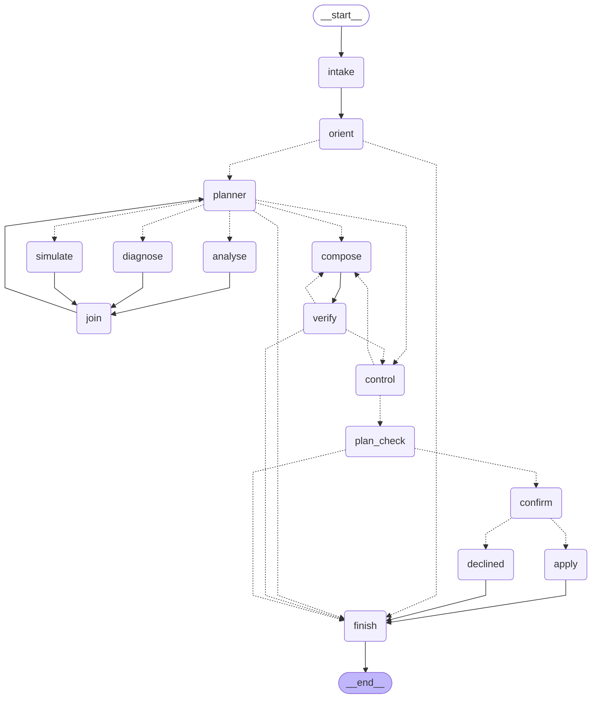

# DTwin

[](https://github.com/zencodelab/DTwin/actions/workflows/ci.yml)

A web-based Digital Twin platform for a single commercial building: stored
spatial geometry, live IoT telemetry, thermal and energy simulation, and an
interactive 3D dashboard for facility managers. The current model is seeded;
an IFC/GLTF import pipeline is not implemented.

**Status: integrated prototype, multi-tenancy migration complete.** The
schema, shared types, telemetry pipeline, alert engine, webhook/log
notifications, thermal worker, and 3D dashboard are implemented, with container
definitions and smoke suites. **All four packages are tenant-scoped** —
tenant-scoped queries, row-level security, API-key and WebSocket-ticket
authentication in `packages/db` and `apps/ingest`; session-resolved tenancy in
`apps/web`; and a context-bound scope in the Python worker. The stack builds and
runs end to end. There are **890 unit tests** (806 vitest, 84 pytest) and
four smoke suites holding **342 checks**, and [CI](.github/workflows/ci.yml)
runs them on every pull request and push to `main` — every check but the web
suite's copilot decision check, which needs a signed-in operator and a model
credential CI does not have, and SKIPs there. On 28 Sep the unit tests and the
database, simulation and web suites were re-run and pass; the ingest suite was
not (CLAUDE.md says why).

The one defect the suite had been carrying is closed. `sim:<runId>` topics could
never be subscribed to — the topic-owner map is keyed by spatial ids and has
never heard of a run id — while the docstring above it claimed they were
"authorised separately". Simulation topics are now keyed by **building**, which
makes authorisation the check the relay already performs. Each of the three
obvious run-keyed fixes turned out worse than the bug, and one of them leaked
across tenants; the reasoning is
[decision 45](docs/decisions.md#45-simulation-topics-are-keyed-by-building-not-by-run).

Email delivery and several reliability gaps also remain. See the dated
[CTO assessment](docs/cto-assessment.md) and
[verification record](docs/operations.md#verification-record) for what was
reviewed and tested.

## Documentation

Start with the [documentation index](docs/README.md). It includes the
[CTO assessment and proposed roadmap](docs/cto-assessment.md),
[architecture](docs/architecture.md), [operations guide](docs/operations.md),
and [API reference](docs/api.md), alongside the schema and design decisions.


## The copilot

A panel beside the 3D view where an operator asks about the building in
words. It answers four kinds of question, and proposes setpoint changes only
for a person to approve:

- **Why** — "why has this office been warm since nine?", from rollups, alerts,
  overrides, the equipment serving the zone and its maintenance log.
- **How much** — "which floor used most energy last week, and what drove
  it?", from end-use and cumulative meters and zone rankings.
- **What if** — "if we raise setpoints 1 K on a 46 °C day, what do we save and
  who gets uncomfortable?", by running the thermal simulator against a
  baseline on a synthetic design day it names (only when
  `COPILOT_SIM_API_KEY` is set).
- **What to change** — a setpoint plan, dry-run against the safety envelope,
  that waits for a person's Approve.

A planner dispatches specialists that never write to the building (diagnose
and analyse read; simulate also writes scratch simulation runs) in parallel
waves. Every tool result becomes a numbered evidence record, and every figure
in the answer is recomputed from the record it cites before the operator sees
it; an answer that fails that check three times is replaced by the evidence
itself, each card with its caveats. Where the data cannot answer, the answer
says so rather than guessing: no weather is stored and the floors measure
within 2% of each other, and each of those comes with a fixed caveat; per-zone
energy is not metered, which the tools' shape enforces (no tool offers energy
by zone) and the prompts' honesty rules make the model say in its own words.

The graph is generated from the compiled LangGraph (`npm run copilot:graph --
--write` rewrites the block below, and a test fails if it goes stale), not
drawn. The safety property is visible in the edges: `apply` — the one node
that writes to the building — has exactly one incoming edge, from `confirm`,
an `interrupt()` that suspends the run until a person approves, and `confirm`
is reached only from `plan_check`, which re-checks the plan against the
envelope first
([ADR 63](docs/decisions.md#63-the-copilot-proposes-a-person-approves-the-graph-makes-that-structural),
[ADR 64](docs/decisions.md#64-the-copilot-investigates-in-parallel-answers-from-evidence-and-reaches-the-building-through-one-door)).

<!-- copilot-graph:start -->

<!-- copilot-graph:end -->

[`video/`](video/) holds a walkthrough of the v1 graph, recorded 24 Sep 2026
— the five-node agent that preceded this one — and one real run through it:
request, dry runs, suspension, approval, the audit trail and the live map,
rendered from the recording, not screen-captured. It is kept as it was; the
rendered MP4 is not committed, and `video/README.md` says how it was made.

## Stack

| Layer | Choice |
|---|---|
| Frontend | Next.js (App Router), Tailwind, TypeScript, @react-three/fiber |
| Ingest | Node WebSocket + HTTP service |
| Simulation | Python FastAPI worker — owns the physics and nothing else |
| Storage | PostgreSQL 17 + TimescaleDB 2.30 + PostGIS 3.6 |
| Contracts | Zod schemas in `@dtwin/types`, shared by every TypeScript service |

Backend topology: Next.js serves the dashboard, reads its data, and proxies
simulation requests. A standalone Node service owns WebSocket fan-out and
telemetry writes; Python owns the simulation. General asset CRUD is not yet
implemented. TypeScript services share Zod contracts.

## Quick start

```bash
cp .env.example .env # fresh checkout only; preserve an existing .env
npm ci
set -a
source .env
set +a
npm run db:up        # TimescaleDB-HA (bundles PostGIS + Toolkit)
npm run db:seed      # applies 001..009 *including* the demonstration building
npm run bootstrap    # first user + the API keys, the copilot's sim-only one included; prints them once
npm run smoke -w @dtwin/db   # end-to-end check against the live database, incl. tenant isolation
```

Use **`npm run db:migrate`** instead of `db:seed` for anything real: it skips
`005_seed.sql` so a deployment does not quietly acquire Corniche Tower. The
choice is per-database and one-way — `007` makes `tenant_id` NOT NULL, so the
seed only inserts in its own chain position. `npm run db:migrate --status`
reports which one a database got.

`npm run bootstrap` is what makes a fresh clone usable: migrations deliberately
ship no user and no API key, and without them nothing in `apps/ingest` can
authenticate. It is idempotent, and `--rotate` replaces the keys atomically.

`.env.example` separates the **application** role (`DATABASE_URL`, subject to
row-level security) from the **schema owner** (`DATABASE_URL_OWNER`, migrations
only) and requires `AUTH_SECRET`; `POSTGRES_APP_PASSWORD` is likewise required
under `NODE_ENV=production`. See
[credentials for a fresh database](docs/operations.md#credentials-for-a-fresh-database).

Local ingest and Python processes do not automatically load the root `.env`;
export it in each service terminal, following the
[environment instructions](docs/operations.md#start-a-development-environment).
Then start each service in a separate terminal:

```bash
npm run dev:ingest              # :8787 — WebSocket fan-out + device simulator; requires AUTH_SECRET
npm run sim:install             # one-off: Python 3.12 venv for the worker
npm run dev:sim                 # :8000 — FastAPI energy/thermal engine
npm run dev:web                 # :3000 — the dashboard; needs AUTH_SECRET and DTWIN_DEMO_TENANT_ID
```

Or, after database startup and migrations, run the applications in containers:

```bash
docker compose --profile app up -d --build
```

`npm run db:psql` opens a shell against the running database, `npm run smoke`
runs all four suites, and `npm run typecheck` covers every TypeScript package.
Smoke suites modify development data and have service prerequisites; see
[change verification](docs/operations.md#change-verification).

The seed creates **Corniche Tower**: 4 floors, 24 zones, 40 equipment items,
190 sensors, 5 thermal profiles, 3 occupancy schedules and 7 alert rules — a
building complete enough to exercise every join, the 3D picking path and the
simulator before any real GLTF or BMS data exists.

## Layout

```
apps/
  web/        Next.js dashboard + 3D view,
              built from the stored geometry       (built, tenant-scoped via session)
  ingest/     WebSocket fan-out, telemetry writer,
              quality gate, alert rule engine,
              device simulator                     (built, tenant-scoped + authenticated)
  sim/        FastAPI energy/thermal worker —
              the only Python, and it owns only
              the physics                          (built, tenant-scoped via context)
packages/
  types/      @dtwin/types — Zod schemas, inferred TS types, WS protocol, tenancy contracts
  db/         @dtwin/db — SQL migrations, pg client (app + owner roles),
              tenant-scoped queries, session/API-key auth, smoke test
docs/
  README.md         documentation index
  cto-assessment.md  capabilities, risks, proposed roadmap
  architecture.md   service boundaries and data flows
  operations.md     setup, configuration, verification, recovery limits
  api.md            HTTP and WebSocket reference
  schema.md         table-by-table reference
  decisions.md      design decisions and rationale
models/       GLTF/GLB building assets
```

## Things to know before changing anything

- **Geometry is in a local metre CRS, not WGS84.** Only `buildings.location` is
  geographic. Do not "fix" the rest to 4326 — it would break area maths and
  detach the data from the 3D scene. See [docs/decisions.md](docs/decisions.md) §1.
- **Enums are defined twice**, in SQL and in `packages/types/src/enums.ts`.
  Adding a value to one without the other fails at the parse boundary.
- **Migrations are raw SQL and append-only.** Add the next unused number
  (currently `007_*.sql`); do not edit an applied file (the runner warns on
  checksum drift but will not re-run it).
- **Cumulative meters need `counter_agg`, never `max - min`.** A meter reset
  otherwise invents a megawatt spike.
- **The database image must be `timescale/timescaledb-ha`.** The plain
  `timescale/timescaledb` image has no PostGIS, and this schema needs both
  extensions in one database.
- **Devices push over HTTP, browsers only subscribe over WebSocket.** That is
  why `ClientMessage` has no telemetry variant. A broker (MQTT, Kafka) slots in
  behind `POST /ingest` without touching anything downstream.
- **Under pressure the ingest service drops telemetry rather than queueing it** —
  both for slow WebSocket clients and for the write buffer during a database
  outage. Alerts bypass batching, but the current socket delivery method can
  also skip them for a slow client. This violates the intended no-shedding rule
  and is tracked in the [CTO assessment](docs/cto-assessment.md).
- **Alert debounce is symmetric** and quality-aware. See
  [docs/decisions.md](docs/decisions.md) §16–18 before changing how rules fire —
  each of those choices exists to stop the alert list becoming noise.
- **The simulation is dynamic, not a load sum**, and HVAC uses ideal-loads
  control. Reacting after the deadband is crossed makes results depend on the
  integration step — see §21–22. The model's stated limits (no latent load, no
  inter-zone transfer, no facade orientation) are at the end of that document
  and matter as much as its outputs.
- **The 3D view is generated from the stored PostGIS geometry**, not a model
  file, so it cannot disagree with the data. See §27–28.
- **React 19, R3F v9 and drei v10 must stay aligned.** Two React copies produce
  a minified error #31 that looks like anything but a dependency problem — the
  note at the end of [docs/decisions.md](docs/decisions.md) has the symptoms.
- **Alert notifications are off by default and the webhook guard is not
  optional.** Rule config is operator-edited input the service makes requests
  from — see §33–34.
- **`npm run smoke -w @dtwin/ingest` refuses to run alongside a live ingest
  service**, because two device simulators writing the same meters make its
  assertions meaningless.

## Rights

© Afsal A Azeez. **All rights reserved.**

This repository is public so the work can be read and reviewed. That is not a
grant of a licence: no permission is given to copy, modify, redistribute or use
it, in whole or in part, in any other project, commercial or otherwise.

There is deliberately no `LICENSE` file — under copyright law the absence of one
means all rights are reserved, not that the code is free to take. If you want to
use any of it, ask.
